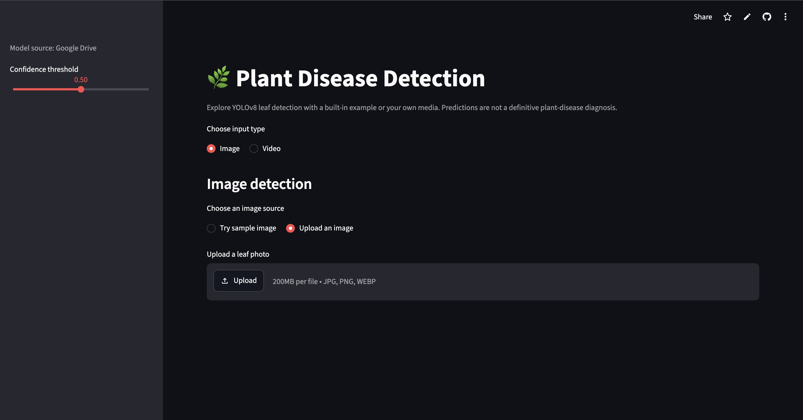
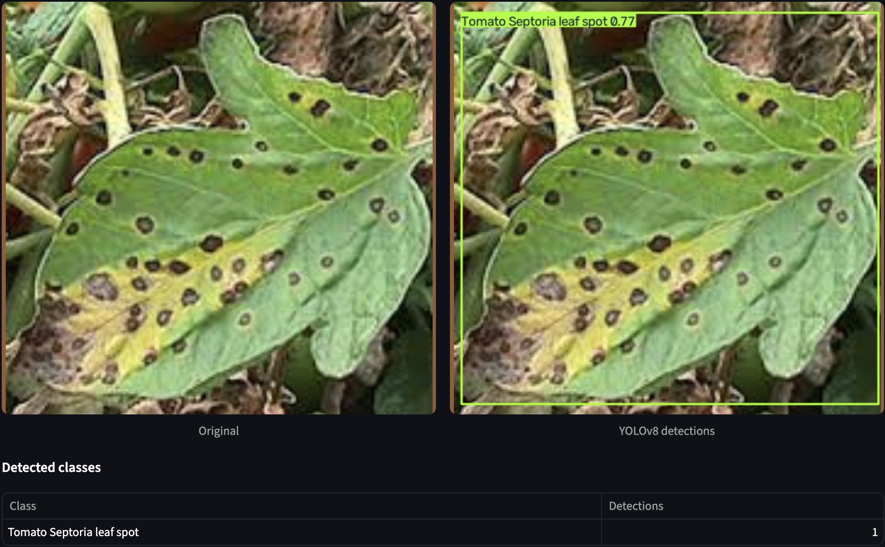
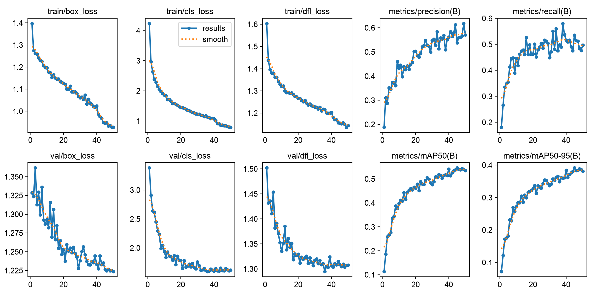
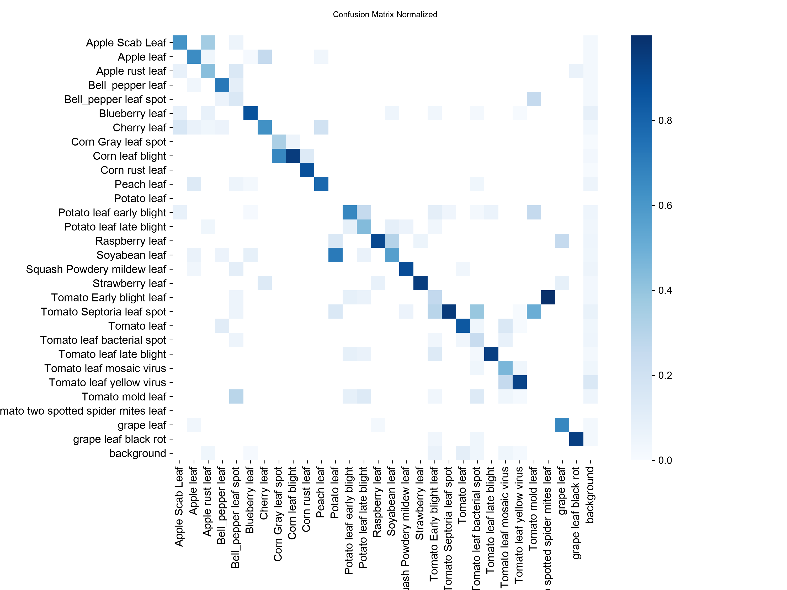
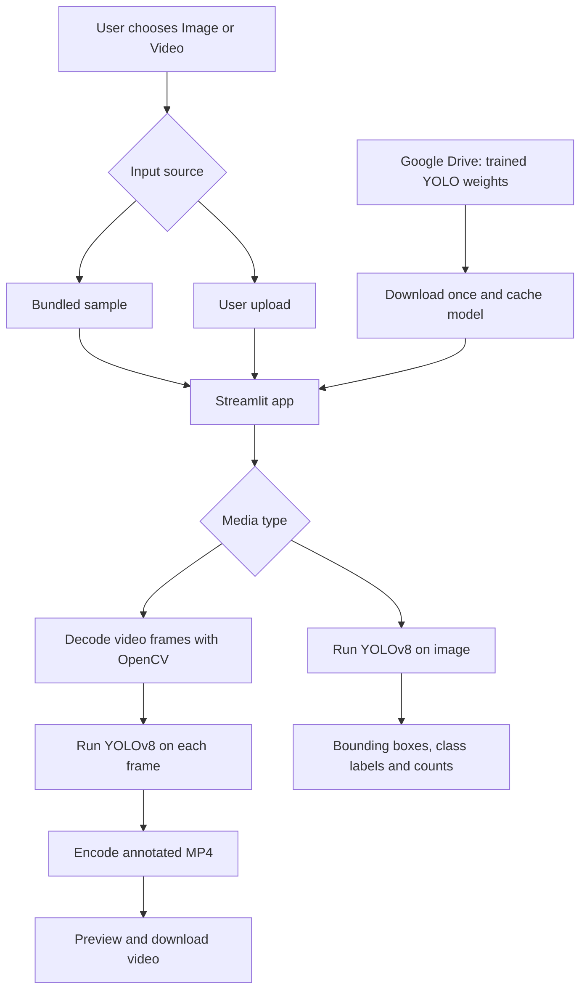

# 🌿 Plant Disease Detection with YOLOv8 and Streamlit

A computer vision application for **detecting and identifying plant leaves and visible disease categories in images and videos**. Built with **Ultralytics YOLOv8**, **OpenCV**, and **Streamlit**, the app draws labeled bounding boxes around detected objects and supports both uploaded media and built-in samples.


[🚀 Try the Live App](https://plant-disease-detection0.streamlit.app/)


## ✨ Features

- **Image detection:** Upload `.jpg`, `.jpeg`, `.png`, or `.webp` files and compare the original image with the YOLO-annotated result.
- **Video detection:** Upload `.mp4`, `.mov`, `.avi`, or `.m4v` files for frame-by-frame inference, a processing preview, and a downloadable annotated MP4.
- **Built-in examples:** Test the app with the bundled sample image and video without uploading a file.
- **Confidence adjustment:** Change the minimum confidence threshold using the sidebar slider.
- **Detection summary:** View predicted class names and detection counts for image inputs.
- **Cloud-hosted model:** Download trained `.pt` weights from Google Drive with `gdown`; cache the loaded YOLO model with Streamlit.
- **Browser-friendly video export:** Use FFmpeg, when available, to convert annotated video to H.264 MP4. Audio from the source video is not retained.

## 🖼️ Demo and screenshots

Add your own screenshots to `assets/screenshots/` and then uncomment the relevant Markdown image lines below. This keeps the README clean until the files are available.

### App overview

> 📸 **Add screenshot:** The app landing page showing the Image/Video selector and confidence control. Suggested file: `assets/screenshots/app_overview.png`.



### Image detection

> 📸 **Add screenshot:** A side-by-side view of an original leaf photograph and its annotated output, preferably with disease labels and confidence scores visible. Suggested file: `assets/screenshots/image_detection.png`.




### Model training and analysis

> 📈 **Optional figures:** Add the YOLOv8 training curves and **validation** confusion matrix used during model development. Suggested files: `assets/figures/training_curves.png` and `assets/figures/confusion_matrix_normalized.png`.




## 🧠 How it works



The model performs **object detection**, not just whole-image classification. A prediction includes a class label, confidence score, and bounding-box location. For videos, inference is applied independently to each decoded frame.

## 📊 Dataset and preparation

The model was developed with the [PlantDoc Object Detection Dataset](https://github.com/pratikkayal/PlantDoc-Object-Detection-Dataset), which contains real-world photographs of plant leaves and diseases. The source dataset provides images and CSV bounding-box annotations. The evaluated baseline uses **29 plant/leaf/disease classes**.

Data preparation included:

1. Converting CSV bounding boxes to YOLO's normalized label format.
2. Resolving missing files and case-sensitive filename mismatches, including filenames that collide on some macOS filesystems.
3. Correcting zero-size image metadata, supported proportional-resize mismatches, and EXIF image orientation where justified.
4. Reviewing conflicts between annotations that share a filename but describe different image sizes.
5. Creating an image-level, class-aware validation split while retaining the original test partition.
6. Visually inspecting corrected bounding-box annotations before training.

### Data split used for the 29-class baseline

| Split | Images | Purpose |
|:--|--:|:--|
| Training | 2,108 | Model fitting |
| Validation | 234 | Training-time evaluation and checkpoint selection |
| Test | 236 | Held-out evaluation |

The test split contains **452 annotated objects**. These counts describe the processed dataset after cleaning; they should not be confused with raw PlantDoc download counts. A single image can contain multiple annotated objects.

> **Dataset availability:** The raw PlantDoc images and cleaned YOLO labels are not currently included in this deployment-focused GitHub repository. The preprocessing and training were performed locally. See the linked dataset and the training commands below for the expected workflow.

## 🏋️ Training

The evaluated baseline was fine-tuned from pretrained **YOLOv8n** object detection weights using a **640 × 640** input resolution for **50 epochs**. The run used the cleaned PlantDoc dataset and a separate validation split.

Once the prepared YOLO-format dataset exists on your machine, an equivalent training command is:

```bash
yolo detect train \
  model=yolov8n.pt \
  data=plantdoc_yolo/data.yaml \
  epochs=50 \
  imgsz=640 \
  batch=16 \
  seed=42 \
  project=runs/detect \
  name=plantdoc_yolov8n
```

## 📈 Evaluation results

The following results are from the **29-class YOLOv8n baseline**, evaluated on the cleaned PlantDoc **test** split (236 images, 452 ground-truth instances):

| Metric | Test score |
|:--|--:|
| Precision | **57.48%** |
| Recall | **61.33%** |
| mAP@50 | **63.03%** |
| mAP@50–95 | **49.41%** |


## 🗂️ Repository structure

```text
plant_disease_detection/
├── streamlit_app.py           # Image and video inference UI
├── requirements.txt           # Python dependencies
├── packages.txt               # Linux system packages for cloud deployment
├── sample_tests/
│   ├── image_test.jpg         # Built-in image demo
│   └── video_test.mp4         # Built-in video demo
├── assets/                   
└── README.md

# Created locally / at runtime (not committed):
.streamlit/secrets.toml         # Google Drive file ID configuration
models/                         # Cached downloaded YOLO weights
```


## 🚀 Run locally

**Prerequisites:** Python 3.12, Git, and internet access on the first run to download the model. FFmpeg is optional but recommended for browser-compatible annotated videos.

### 1. Clone the repository

```bash
git clone https://github.com/Stan-Leigh/plant_disease_detection.git
cd plant_disease_detection
```

### 2. Create and activate a virtual environment

```bash
python3.12 -m venv .venv
source .venv/bin/activate
```

For Windows, use `.venv\Scripts\activate` instead.

### 3. Install dependencies

```bash
python -m pip install --upgrade pip
python -m pip install -r requirements.txt
```

On macOS, you can optionally install FFmpeg using Homebrew:

```bash
brew install ffmpeg
```

### 4. Configure the model download

Upload your trained `best.pt` file to Google Drive and grant **Anyone with the link — Viewer** access if you want anonymous app deployments to download it.

Create `.streamlit/secrets.toml`:

```toml
GDRIVE_FILE_ID = "YOUR_GOOGLE_DRIVE_FILE_ID"
```

For a Drive link such as `https://drive.google.com/file/d/FILE_ID/view`, use only the `FILE_ID` portion. Streamlit downloads the file with `gdown`, stores a local model copy, and caches the loaded YOLO model during the app session.

**Do not commit `.streamlit/secrets.toml`, downloaded model files, or virtual environments.** Include these entries in `.gitignore`:

```gitignore
.venv/
.venv312/
.streamlit/secrets.toml
models/
__pycache__/
```

### 5. Start the application

```bash
streamlit run streamlit_app.py
```

Open the local URL printed by Streamlit. Select **Image** or **Video**, then choose a built-in sample or upload your own file.

## ☁️ Deploy to Streamlit Community Cloud

1. Push `streamlit_app.py`, `requirements.txt`, `packages.txt`, and the two sample media files to your GitHub repository.
2. Create a new application on [Streamlit Community Cloud](https://share.streamlit.io/) connected to this repository, selecting `streamlit_app.py` as the entry point.
3. In the deployment's **Secrets** settings, add `GDRIVE_FILE_ID = "YOUR_GOOGLE_DRIVE_FILE_ID"`.
4. Check the application logs during first startup as the model is downloaded and loaded.
5. Test both the sample image and sample video paths after deployment.

The repository's `packages.txt` supplies Linux libraries used by OpenCV (`libgl1` and `libglib2.0-0`). For reliable H.264 MP4 encoding on the cloud server, **add `ffmpeg` to `packages.txt`** if it is not installed in your deployment environment. Without FFmpeg, the application may return an MP4 file that some browsers cannot preview.

Public Google Drive downloads can be rate-limited or fail if permissions change. For a larger deployment, consider hosting versioned model artifacts on a model-oriented service instead.

## ⚠️ Current limitations

- **Dataset imbalance and coverage:** Some classes are represented by very few independent images; two of the 29 classes have no annotated test examples.
- **Domain shift:** Test-set metrics may not carry over to new farms, crop varieties, cameras, lighting conditions, or disease stages.
- **Not an agronomic diagnosis:** The model reports visual predictions, not confirmed plant pathology or treatment recommendations.
- **Video temporal consistency:** Frames are processed independently; class labels may change between neighboring frames.
- **Video size and resources:** Full uploaded videos are processed in memory; long clips may be slow or memory-intensive on hosted instances.
- **Audio:** Annotated exported videos do not retain the source audio.

## 🛣️ Future improvements

- Collect more diverse examples of rare or difficult disease categories and assess them on an external holdout set.
- Compare the current 29-class baseline with a carefully evaluated 27-class model and, later, larger YOLO variants.
- Perform systematic per-class error analysis, annotation auditing, and duplicate/near-duplicate leakage checks.
- Add video tracking or temporal smoothing to reduce frame-to-frame label fluctuations.
- Improve batch/video inference efficiency and introduce input-size/duration limits for cloud deployment.
- Add a model-information panel that clearly lists supported classes and limitations.

## 🙏 Acknowledgements and references

- **PlantDoc dataset:** [PlantDoc Object Detection Dataset](https://github.com/pratikkayal/PlantDoc-Object-Detection-Dataset) by the PlantDoc authors; see [Singh et al., *PlantDoc: A Dataset for Visual Plant Disease Detection* (2020)](https://doi.org/10.1145/3371158.3371196). The source dataset is made available under **CC BY 4.0**; attribute any redistributed sample images appropriately.
- **Frameworks:** [Ultralytics YOLO](https://docs.ultralytics.com/), [Streamlit](https://streamlit.io/), [OpenCV](https://opencv.org/), and [gdown](https://github.com/wkentaro/gdown).

**Project repository:** [Stan-Leigh/plant_disease_detection](https://github.com/Stan-Leigh/plant_disease_detection)
